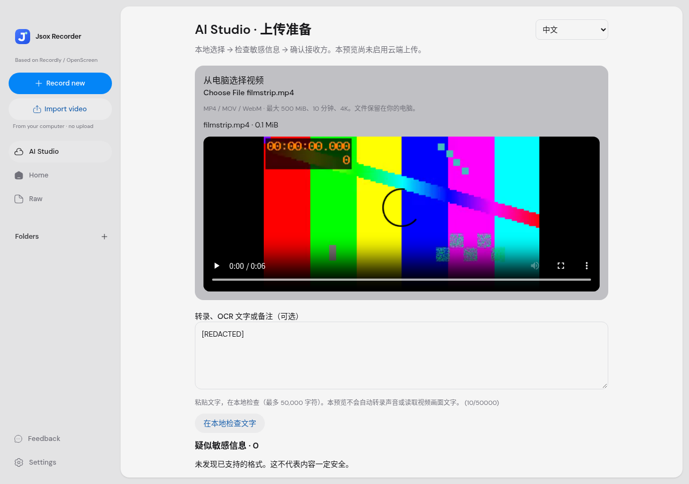

# Jsox AI Studio：本地上传准备预览（M2a）

本轮是桌面可测试的上传前检查。**未接通实际上传、Firebase 登录、Gemini 分析或 B-roll 云端工作流**。现有本地录屏、导入和时间线继续使用，不要求邮箱账号；不新增依赖或下载模型。`cloud/` M1 基础保留，生产安全门槛见 [架构](firebase-ai-studio-architecture.md)。

## 怎么打开

1. 下载最新 `jsox-preview` 源码 ZIP，完整解压。
2. 已安装 Node.js 22 的 Windows 电脑，双击根目录 `START-DESKTOP.cmd`。首次会安装现有依赖，需要网络；这不是 Windows 安装包。
3. 在 Home 左侧点击 **AI Studio**，右上可选中文 / English / Bahasa Melayu。
4. 选择本地 MP4 / MOV / WebM（非空、≤500 MiB、≤10 分钟、≤4K）。浏览器能解码的格式可预览；容器支持不代表所有编码都能播放。其他素材仍可走原有 Import video。
5. 可粘贴转录、OCR 文字或备注，点击「在本地检查文字」。不要求已有转录；空文字也须主动运行检查。
6. 对每个候选逐项检查，或移除检出的文字并重新检查。确认完整视频/声音人工审查和计划接收方说明后，完成本地准备。

完成后显示「本地准备完成，没有上传」。没有可执行上传按钮；勾选不会产生云端授权凭据，也不会沿用到将来的真实上传。真实操作仍须披露实际模型、地区、费用、供应商条款并重新取得同意。

下图是本环境 Chromium 的真实页面截图，使用合成视频和 Electron 测试 bridge；不是 Windows 实机录屏验收。



## 已实现的行为

- 视频通过本机 Blob URL 预览，离开时回收 URL。文件、文字、候选和勾选只保存在页面内存，不写浏览器持久存储、Firestore 或日志。
- 检查邮箱、SG/MY/CN 常见电话格式、疑似 SG NRIC/FIN、MY 身份证格式、AWS/GitHub/Google 常见密钥、Bearer、通用 secret/password 字段及私钥头。
- 候选列表只显示类别及字符位置，不复制展示原始值。重叠候选可一次移除；原始文件不变。
- 文字上限 50,000 UTF-16 字符，候选超过 100 时检查不完整，不能完成准备。文件/文字改变会重置检查/确认；退出 AI Studio 即清除。
- Google 私有 Storage/Firebase、Gemini、将来 Pexels/Pixabay 的接收内容分别说明。未来素材搜索仍需单独同意。

## 验证与限制

本次实测：10 项 Vitest 单元测试、3 项 Playwright 页面测试，以及 2 项已有本地导入回归测试通过。真实 Chromium 解码仓库的合成 MP4，验证逐项确认、撤回同意、文字/文件变更重置、内存清理、三语言文案、无新增外部请求、损坏视频及候选溢出保护。桌面 TypeScript 检查和 Vite renderer/main/preload 生产构建通过；现有 PostCSS/大 chunk 警告保留，不代表 Windows 安装包已构建。

这些是**合成文本和合成视频的功能检查**。不是新马真实用户隐私召回率、ASR WER/CER、OCR 错误率、翻译质量或低配性能报告。马来文及三语混说真实样本尚未测试，不声称识别质量已可用。

格式匹配可能误报和漏报：不验证身份证校验码；任意人名、人脸、住址、变形/分段/零宽字符、未知密钥、加密内容都可能漏掉。全角 ASCII 有有限转换，非完整 Unicode 去混淆。**本页没有自动 OCR、ASR 或视频打码**，移除文字不会修改画面或声音。媒体 metadata 检查不是安全解码沙箱或服务端上传验证的替代品。以后添加画面/音频扫描后仍须人工审阅。

## 复现自动检查

```sh
npx vitest run src/components/video-editor/ai-studio/preflight.test.ts
npm run typecheck
```

浏览器测试需要 Chromium 及现有桌面 bridge fixture，测试文件 `tests/ui/ai-studio-preflight.spec.ts`。本环境采用 Chromium `/usr/bin/chromium` 和只渲染前端的 Vite，Electron IPC 为测试 bridge；不能据此认定 Windows 实机录屏通过。新云端安全 Rules/事务验收仍被本环境官方 Emulator 下载 HTTP 403 阻塞。

已安装 Playwright Chromium 的电脑可运行：

```sh
npx playwright test tests/ui/ai-studio-preflight.spec.ts tests/ui/home-import.spec.ts --workers=1
```

下一步前置项见 [用户准备清单](jsox-cloud-preparation.md)，不把准备页面视为已上线的完整云端编辑器。
