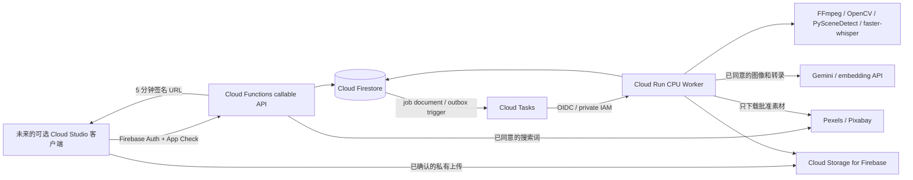

# Firebase AI Studio 架构与接口 v1（增量核对版）

## 1. 代码核实与架构

当前核查基线：`c6d52c0b`。仓库已包含 `434eda57` 的 Firebase 后端基础和 `c6d52c0b` 的桌面本地上传准备 UI，不重复新建后端。最初在 `bfa6b314` 之后新增后端，是因为当时只有网站 Hosting 配置。现有 Electron/React/PixiJS、录屏、导入、音轨、`.recordly`、本地 AI 建议继续保留。

`website/firebase.json` 只配置 Hosting；`cloud/firebase.json` 独立配置 Functions、Firestore、Storage 与本地 Emulator。两边 `.firebaserc` 均绑定已有项目 **d-recorder-ef064**。这些文件证明仓库已有配置，**不能证明线上服务启用、资源位置、权限或测试通过**。旧 Supabase 账号代码仍保留且本地产品不启用；未迁移身份或业务数据，未部署收费资源。初版应用不引入 PostgreSQL / pgvector。

十项交付入口与实际状态：

| 交付物 | 具体实现/说明 | 当前状态 |
|---|---|---|
| 1. Firebase 架构 | 本文 §1；`cloud/firebase.json` | 配置及设计已保存，未部署 |
| 2. Firestore schema | 本文 §2；`cloud/functions/src/service.ts`、`cloud/worker/app.py` | 小文档/不可变版本代码已实现，大版本外置仍为设计 |
| 3. Security Rules | `cloud/firestore.rules`、`cloud/storage.rules` | 已编写；真实 Emulator 验收被下载 403 阻塞 |
| 4. Storage 结构 | 本文 §4；`cloud/storage.lifecycle.json`、`cloud/storage.cors.example.json` | 私有路径/签名接口代码；线上 IAM/CORS 未验证 |
| 5. Cloud Functions | `cloud/functions/src/index.ts`、`service.ts` | 编译与本地契约测试通过；未调用线上服务 |
| 6. CPU Worker | `cloud/worker/Dockerfile`、`app.py`、`media.py` | 合成媒体处理通过，镜像和云端运行未验证 |
| 7. API contracts | 本文 §7；`cloud/functions/src/domain.ts` | 有界协议、权限、幂等、严格拒绝不支持字段 |
| 8. AI 搜索 | `cloud/functions/src/search.ts`、`firestore.indexes.json` | tenant query/keyword/vector 代码；生产向量索引和质量待测 |
| 9. Assisted Mix | 本文 §9；[分阶段计划](ai-assisted-mix-plan.md) | 后端基础 + 本地准备 UI；完整云端用户流程未接通 |
| 10. 成本优化 | 本文 §10；Tasks/TTL/lifecycle 配置、usage 账本 | 限流/复用/清理代码和策略；费率、实际成本及留存上线待验收 |



Cloud Functions 负责控制流、鉴权、预算和状态；重处理不在 Functions 请求中等待完成。Cloud Run 同时处理 1 个任务，最小实例 0，无 GPU；初始建议 4 vCPU/8 GiB 是待验证配置，不是低配速度或容量保证。选择数据库、Storage、Functions、Tasks、Run 同区域/近区域需先确认现有资源；示例 `asia-southeast1` 不代表线上已配置为新加坡。

## 2. Firestore schema

所有名称使用实际代码中的小写/camelCase；文档目标体积不超过约 200 KiB，远小于 Firestore 1 MiB 限制。Binary 不进入 Firestore。

| 路径 | 核心字段/约束 |
|---|---|
| `users/{uid}` | `workspaceIds, createdAt`；不重复保存邮箱和敏感身份资料 |
| `workspaces/{ws}` | `name, createdBy, schemaVersion, createdAt` |
| `workspaces/{ws}/members/{uid}` | `role: owner/editor/viewer, active`；仅服务端管理 |
| `.../videos/{videoId}` | `createdBy, storagePath, sizeBytes, contentType, status, consent, fingerprint, sourceGeneration, analysisJobId, analysisKey, analysisCacheKey, analysisModel, asrModelRevision, durationMs`；当前任务、可见 generation 和复用 key 分开 |
| `.../videos/{videoId}/scenes/{generation-index}` | `startMs,endMs,analysisKey`；场景检测最多 500 段 |
| `.../videos/{videoId}/transcripts/{generation-index}` | `startMs,endMs,text,language,analysisKey`；每段 text ≤5000 字符、最多 500 段 |
| `.../videos/{videoId}/events/{generation-index}` | 抽样画面的描述、时间、描述模型、analysisKey；不代表完整逐帧事件检测 |
| `.../videoEmbeddings/{videoId-generation-index}` | `workspaceId,videoId,analysisKey,kind,text,startMs,endMs,model,descriptionModel,embedding,keywords`；768 维原生 vector |
| `.../aiMixProjects/{projectId}` | `name,currentVersion,createdBy,updatedAt` |
| `.../brollSuggestions/{id}` | `provider,providerAssetId,sourceUrl,previewUrl,licenseUrl,termsVersion,durationMs,downloadUrl`；元数据，不下载未审批媒体 |
| `.../assetApprovals/{suggestionId}` | `approved,approvedBy,decidedAt,licenseReviewed,usageRightsConfirmed,revision,sourceUrl,licenseUrl,provider,termsVersion`；工作区共享资产审批 |
| `.../timelineVersions/{versionId}` | `projectId,fingerprint,createdBy,width,height,fps,clips[]`；不可覆盖，clip ≤100，JSON ≤200 KiB |
| `.../exportJobs/{jobId}` | `kind:analyze/render,targetId,status,createdBy,cancelRequested,leaseToken,leaseUntil,attempts,quotaPath,reservedUnits,outputPath,approvalRevisions` |
| `.../aiUsageRecords/{operationId}` | 用户、工作区、Job/Provider/Model、预留/退款单位、调用/Token/字符/产物秒数/Worker 墙钟秒数；`actualCostUsd:null, estimatedCostUsd:null, costStatus:unpriced` 在未定价时保留未知 |
| `.../aiUsageRecords/{jobId}/attempts/{leaseToken}` | 每次实际处理的 provider/model/embeddingModel/asrModelRevision、metrics 和状态；服务端诊断使用，重试不会覆盖前一次模型记录 |
| `.../auditLogs/{randomId}` | `uid,action,target/jobId,createdAt`；审计产品操作，不是匿名遥测；不存原文、密钥或视频 |
| `.../_quotas/{uid-day-hash}` | 每日单位预留/使用计数，上限 100；最终失败/取消只退款一次 |
| `.../_uploadQuotas/{uid-day-hash}` | 每天允许预留 2 GiB 原视频上传；取消未上传 slot 目前不回收容量，属于防滥用上限 |
| `.../_rateLimits/{uid-minute-hash}` | 每用户/工作区 30 次/分钟；不是全球分布式 DDoS 防护 |
| `.../_queryEmbeddings/{model-query-hash}` | 私有短时查询向量缓存，1 小时过期，代码显式检查过期时间 |

使用哈希/随机 ID 避免顺序写热点。每个时间线版本必须带 `expectedVersion`；同 request ID 同 payload 返回相同版本，不同 payload 拒绝，避免覆盖他人修改。上传/任务的 request ID 有相同保护。修改业务对象的事务会重新读取成员权限，避免初始鉴权后被撤销仍提交变更。Firestore transaction 所有读在写之前；分析文档分批 ≤100 写，素材候选使用小批量写。

**大型时间线扩展（设计，尚未实现）**：版本头保存 `storagePath,sha256,size,schemaVersion,parentVersion`，主体存私有 `timelines/...json`；先临时上传、校验内容/引用及大小、事务发布版本指针。当前 API 超过限制直接拒绝，不把大文档偷偷写入 Firestore。旧分析 generation 尚未实现自动 Firestore 清理，需在部署前确认保留/清理任务，避免长期积累。

## 3. Security Rules 与服务端权限

`cloud/firestore.rules`：匿名和跨工作区读拒绝；用户只读自己的用户文档，工作区通过 active 且具有有效角色的成员判断；用量仅本人/owner 可读、审计仅 owner 可读；客户端不能直接写成员、审批、账本、任务和版本。服务端 Admin SDK 绕过 Rules，因此每个 callable 再检查 Firebase Auth、App Check、角色及工作区引用。成员管理 UI/API 后续实现，当前个人工作区创建为 owner。

`cloud/storage.rules`：拒绝客户端直接写原视频；上传改用 Functions 在验证工作区/上传者、精确字节数、MIME 和 500 MiB 上限后签发的 15 分钟 GCS PUT URL，绑定 Content-Length、Content-Type 和 generation-match=0，禁止覆盖。避免 Firebase SDK 自动生成长期 download token。签名上传绕过 Rules，安全性由签名约束和服务端授权负责；真实 GCS 签名/CORS 行为仍需 staging 验证。原片格式声明不是内容验证，Worker 仍用 ffprobe 验证媒体、4K/10 分钟等处理边界。客户端不能直接读导出/临时对象；导出必须通过授权 API，防止绕过素材撤销检查。批准素材读取还需当前批准状态。

App Check 在所有 callable 上 `enforceAppCheck:true`，不能代替登录或租户检查；桌面 attestation 策略未验证，不能把生产 debug token 嵌入客户端。云端 API/客户端接入未上线，不影响现有无邮箱的本地启动。

## 4. 私有 Cloud Storage 结构

```text
workspaces/{ws}/originals/{videoId}/source
workspaces/{ws}/thumbnails/{videoId}/{analysisKey}-{sample}.jpg
workspaces/{ws}/approvedBroll/{assetId}/source.mp4
workspaces/{ws}/timelines/{projectId}/{versionId}.json   # 大版本预留
workspaces/{ws}/rendered/{projectId}/{versionId}.mp4    # 中间合成预留
workspaces/{ws}/exports/{jobId}/{leaseToken}.mp4
```

实际 CPU MVP 将最终合成文件直接写入 exports，中间 rendered 和大 timeline 路径为预留设计，未伪称已经生成。Bucket 启用 uniform bucket-level access、public-access prevention，不生成 public ACL/token；签名 PUT 需要限制正式 Studio origin 的 CORS（模板见 cloud/storage.cors.example.json），不使用通配来源。Functions 签发 5 分钟 V4 URL，签发前再次检查当前成员、Job 成功和素材审批 revision；签发后不能立即撤销已发 URL，需等待过期或删除对象。

仅派生产物设置 GCS customTime；`cloud/storage.lifecycle.json` 对这些对象 7 天后清理。原片不设置 customTime，因此不会被该策略误删。任务 tempfile 随上下文自动删除。原片/Firestore 记录、用户主动删除、账号删除和法律保留策略是独立待实现事项，部署前不得用派生清理策略替代它们。

## 5. Cloud Functions 与任务协议

`cloud/functions/src/index.ts` 导出：`createWorkspace,createVideoUpload,createMixProject,decideAsset,saveTimelineVersion,analyzeVideo,renderMix,cancelJob,searchVideos,findBroll,getExportDownload`。

`enqueueStudioJob` 是 Firestore on-create outbox trigger，仅处理 `pipeline:cpu-mix-v1` 的排队任务，并验证文档路径与工作区字段一致、任务类型和目标 ID 合法；忽略共用集合里的其他 pipeline。取消、Worker claim/完成和下载签名也校验 pipeline 与工作区，不能用本系统接口修改别的产品任务。Job ID 包含工作区，Cloud Tasks 同名去重，ALREADY_EXISTS 安全处理，不在 Firestore 事务中调用外部 API。`reconcileExpiredJobs` 每 15 分钟限量处理超过 3 小时且无有效租约的残留任务，事务中退款一次。需要部署复合索引及 Scheduler；当前未部署。

任务 body：`{workspaceId,jobId}`，不接受任意下载 URL、命令行或 uid。Cloud Tasks 使用专用服务账号 OIDC，audience 是私有 Cloud Run URL；Cloud Run 必须 `--no-allow-unauthenticated`，只给该账号 Run Invoker。Functions 调度身份需要 Tasks Enqueuer 及对任务服务账号的 actAs；Worker 只获所需数据库/私有 Bucket/秘密读取权限。签 URL 的 Functions 服务账号需要相应 signBlob 权限。部署前逐项验证 IAM，源码本身不创建这些授权。

## 6. Cloud Run CPU Worker

`cloud/worker/`：FastAPI 接收私有任务；Firestore transaction claim/租约，重复成功任务不重复处理，有效租约返回可重试 503。最多 3 次真正处理；queue delivery retry 独立配置，见 `cloud/cloud-tasks.queue.yaml`。单次阶段/总时限受控，FFmpeg/场景子进程可取消，ASR 在段边界检查；不是任意时刻的硬实时取消。

分析：校验 upload slot/consent/generation/大小 → 按 generation、pipeline、Gemini、embedding 维度及 **Whisper 模型 revision** 计算 `analysisCacheKey` → PySceneDetect 分段 → CPU int8 faster-whisper（有音频时）→ OpenCV 最多 8 张抽样 → Gemini 描述和 embedding → 有限批次写小文档 → 原子发布可见结果。音频分析必须配置经过验证的 Whisper revision；改变权重 revision 会使旧缓存失效，不能只改目录后复用旧转录。

新分析任务在排队事务中成为视频的 `analysisJobId`；重放旧请求不会抢回指针。每次尝试用 cache key + lease token 组成独立 `analysisKey` 写入分段，防止重试/并发任务相互覆盖尚未发布的内容。Worker 完成事务同时检查租约、取消、成员权限和当前任务指针，**只有成功时才一起发布 ready generation 和结算任务**；取消/被新任务替代不会发布半成品。旧已发布结果可保留到新结果成功替换，不删除用户编辑。未发布/过期 generation 仍需部署前补齐 Firestore 清理策略。

搜索过滤未发布和旧 generation；向量近邻候选后过滤可能少于请求条数，不声称召回完整。

渲染：读取不可变版本 → 严格验证协议 → 检查原视频/素材审批 → 仅下载批准的 B-roll → 统一 1280×720/30 fps/音轨 → FFmpeg 剪切拼接 → 最终事务再次核对授权 → 私有 MP4。当前云端 timeline v1 只有有序片段，不包含 PixiJS 缩放、光标、背景、转场或音轨叠加；API 和 Worker 都拒绝不支持的字段，不能通过默默忽略字段“成功”导出。桌面原导出路线保持原状。

Whisper 权重必须预先审阅并放进 `WHISPER_MODEL_DIR`，开启离线模式、local_files_only，不在启动下载模型。Gemini 分析模型 ID 必须部署者选择并验证当前区域/费用，未提供假定可用默认。初版无 GPU。

## 7. API contracts

调用方式：Firebase callable 协议，Web SDK `httpsCallable`；业务 input 包在 `data` 内，不能当普通无认证 REST。当前没有新增前端 Firebase SDK；桌面 AI Studio 仅提供本地上传准备界面，不发送云端请求。

| API | 输入关键字段 | 返回 |
|---|---|---|
| createWorkspace | `name` | `workspaceId`，当前每用户一个个人工作区 |
| createVideoUpload | `workspaceId,requestId,name,sizeBytes,contentType,consent:{cloudProcessing:true,gemini:true,sensitivityReviewed:true}` | `videoId,storagePath,maxBytes,uploadUrl,expiresAt,headers`；客户端以 Blob PUT 到短时签名 URL，浏览器自动提供精确 Content-Length |
| analyzeVideo | `workspaceId,videoId,requestId` | `jobId`，服务端先核对已上传对象元数据 |
| createMixProject | `workspaceId,name` | `projectId` |
| searchVideos | `workspaceId,mode:keyword/semantic,query`；语义另需 `requestId,geminiConsent,sensitivityReviewed` | 有限 `results`；不返回向量或秘密 |
| findBroll | `workspaceId,requestId,provider,query,providerConsent,sensitivityReviewed` | 最多 5 条元数据，包含许可/来源页，不返回供应商 Key |
| decideAsset | `workspaceId,suggestionId,approved`；批准时必须 `licenseReviewed:true,usageRightsConfirmed:true`，拒绝/撤销时不要求正面授权声明 | 持久化实际确认结果；拒绝可处理不完整/未获授权候选；批准要求有效供应商来源/许可页 |
| saveTimelineVersion | `workspaceId,projectId,requestId,expectedVersion:null/string,timeline` | `versionId` |
| renderMix | `workspaceId,versionId,requestId` | `jobId` |
| cancelJob | `workspaceId,jobId` | `jobId`；排队任务立即一次退款，处理中合作式取消 |
| getExportDownload | `workspaceId,jobId` | `url,expiresAt` |

Timeline v1：

```json
{"width":1280,"height":720,"fps":30,"clips":[{"assetType":"original","assetId":"VIDEO_ID","startMs":0,"endMs":3000},{"assetType":"broll","assetId":"APPROVED_SUGGESTION_ID","startMs":0,"endMs":2000}]}
```

客户端 timeline 只接受上述字段；每个 clip 只接受 `assetType,assetId,startMs,endMs`。传入 `zoomRegions`、`audioTracks`、`speed` 等未支持字段明确返回 invalid-argument；存储记录可额外包含已知的工作区/版本归属与创建元数据，不开放任意扩展字段。不要直接把完整桌面时间线发给简化渲染器。

错误使用 Firebase callable codes：unauthenticated、permission-denied、invalid-argument、aborted（版本冲突）、resource-exhausted、already-exists（供应商请求正在处理）、internal。错误不回显供应商含密钥 URL。Provider usage 的最终成功结果可按同请求 ID 重放；正在处理的同 ID 不再次发外部请求，失败的 reservation 保留以防重复滥用。它不是支付系统。

## 8. AI 搜索实现

`StudioSearchEngine` 接口 → `FirestoreSearchEngine`，未来可替换专用搜索实现而不改变 callable 合同。当前所有查询从 `workspaces/{ws}/videoEmbeddings` 发起，同时筛选 workspaceId，语义再按 embedding model 筛选；禁止全局 collection-group vector search 后再靠前端过滤租户。

使用 `gemini-embedding-001`/768 维；Worker 用 RETRIEVAL_DOCUMENT，查询用 RETRIEVAL_QUERY。具体模型可用性/API 版本和区域需线上验证。索引定义见 `cloud/firestore.indexes.json`；模拟器不能代替真实 vector index 验收。接口与编译已检查，真实语义质量/索引部署未测。

关键词只做 Unicode token/中文二元片段的 array-contains-any，最多 5 个查询词、20 个候选，无排序相关性保证、词干、模糊、拼写纠正或全文引擎能力。中文/马来文例子只是单元测试，不是自然语言搜索准确度报告。

## 9. AI Assisted Mix 实施状态

目前是后端基础增量：上传 slot、分析任务、素材搜索/人工审批、版本化片段列表、CPU Render 和导出授权代码。桌面已有 [M2a 本地视频预览、粘贴文字敏感格式检查、逐项确认和计划供应商披露](ai-studio-preflight-test.md)，但真实上传保持关闭。自动画面/声音隐私扫描、真实 Auth/App Check、任务/素材审批 UI、可编辑 Mix 时间线、自动候选组装以及与 Recordly `ClipRegion`/PixiJS 逐项兼容转换尚未完成。不能把这些后端接口描述成用户已能点击完成的成品。下一增量详见 [实施计划](ai-assisted-mix-plan.md)。

## 10. 成本优化与部署前置

- 无常驻 GPU，Cloud Run min=0/max=1/concurrency=1，Tasks 同时分发 1 个任务；CPU/内存规格按真实 10 分钟样本压测后决定。
- 单视频 ≤500 MiB/10 分钟/4K，导出 ≤100 clips/10 分钟/720p；合并下载输入 ≤1 GiB，云端编码视频码率上限 6 Mbps；内存峰值仍需压力测试，不能视为完整资源沙箱。
- Firestore 点查与有界候选，不加全库实时监听。job 状态轮询应带退避，用户打开某个任务时才考虑一个 document listener；还没有前端 listener。
- 复用 generation/pipeline/Gemini/embedding/Whisper revision 匹配的完整分析；查询 embedding 缓存 1 小时。B-roll 搜索目前只做请求级幂等结果重放，不做跨请求供应商缓存；重复导出仍可能重复下载已批准素材。部署前按 Pexels/Pixabay 最新条款限制留存、缓存及重放时间。代码通过 STOCK_TERMS_REVIEWED=false 默认关闭素材搜索及素材渲染，未审阅不能对外开放素材 API；不得只把开关改为 true 而跳过相应限期实现。
- 初始分析 10 配额单位、Render 5、语义/素材请求 1，用户每天 100；是工程防滥用参数，非商业定价。配额失败/取消退款与实际供应商成本分开，已经发生的供应商费用不会神奇退款。
- `actualCostUsd:null` 表示尚未取得实际账单，不等于免费；`estimatedCostUsd:null` 表示没有已验证的价格表。已经记录 CPU 墙钟、GPU=0、模型/调用/Token/字符/生成秒数；embedding API 未返回的 token 数不凭字符数伪造。接入验证过的地区/模型费率和 Billing 对账后才填写金额。
- TTL 为异步删除，也有费用；应用自己检查 expiresAt/日期，不靠 TTL 正确限流。派生对象 7 天删除需要显式应用 lifecycle，尚未应用。
- API Key 用 Secret Manager；预算告警不是硬停机开关。真正上线前设置项目预算、供应商额度、任务并发、最大实例、日志保留与过期清理。

## 来源与证据

以下是官方设计依据入口；当前环境部分 Google 页面/模拟器下载为 403，不把未取得的实时费率、区域能力和生产测试说成已验证。

- [Firestore 数据结构/限制](https://firebase.google.com/docs/firestore/quotas)、[事务](https://firebase.google.com/docs/firestore/manage-data/transactions)、[最佳实践](https://firebase.google.com/docs/firestore/best-practices)
- [Firestore vector search](https://firebase.google.com/docs/firestore/vector-search)、[全文搜索边界](https://firebase.google.com/docs/firestore/solutions/search)
- [Firebase App Check](https://firebase.google.com/docs/app-check)、[Storage Rules 与 Firestore](https://firebase.google.com/docs/storage/security/rules-conditions)
- [Cloud Tasks 的 Cloud Run 目标](https://cloud.google.com/run/docs/triggering/using-tasks)、[Storage 签名 URL](https://cloud.google.com/storage/docs/access-control/signed-urls)、[生命周期](https://cloud.google.com/storage/docs/lifecycle)
- [Gemini embedding](https://ai.google.dev/gemini-api/docs/embeddings)、[Gemini 定价](https://ai.google.dev/gemini-api/docs/pricing)
- [Pexels API](https://www.pexels.com/api/documentation/)、[许可](https://www.pexels.com/license/)、[Pixabay API](https://pixabay.com/api/docs/)、[许可](https://pixabay.com/service/license-summary/)
