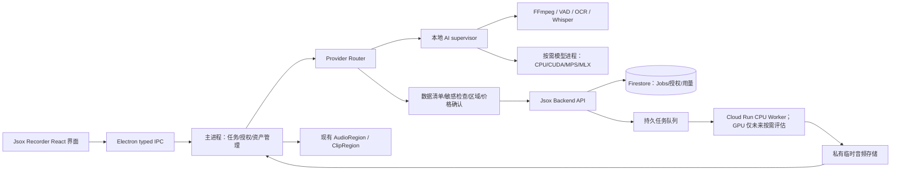

# Jsox Recorder：开发前评估与交付方案

> **架构更新**：云端第一版以 [Firebase Master Prompt](recordly-ai-studio-master-prompt.md) 和 [Firebase 架构](firebase-ai-studio-architecture.md) 为准：Auth / Firestore 原生向量搜索 / 私有 Storage / Functions / App Check，加 Cloud Tasks 与 CPU Cloud Run。不引入 SQL 或 pgvector，不要求 GPU。本文语音研究为历史评估，声音克隆继续暂缓；不把历史规划当成本轮已实现功能。

产品名称确定为 **Jsox Recorder**。产品界面和对外介绍使用该名称；Recordly 与 OpenScreen 作为上游项目保留归属说明。本次交付是代码复核、官方资料研究和工程方案，没有继续编写产品功能、安装模型、发起付费调用或部署服务。此前已实现的规则剪辑方案保留，不把它重复计为本轮新增成果。

证据等级：**已核查**＝当前代码或固定提交的官方文档；**上游宣称**＝官方文档给出的能力／指标但未经本项目复测；**设计／假设**＝拟采用方案；**待验证**＝缺少工件、价格或真实样本证据。项目参数量不是完整下载大小，更不是运行所需 RAM／显存。

本次公开 GitHub 文档可读；Hugging Face 和 RunPod／Modal／OpenAI 价格页被当前网络代理返回 403，因此不把相关页面的权重许可证、工件大小或现价写成已核实事实。固定来源提交、读取结果见 [来源清单](research/ai-source-manifest.json)。

## 1. Recordly 现有功能分析

基准：`52a913569afa0229c5a3c116f0c93b828ededb84` 加本工作区先前的未提交自动剪辑改动。当前 origin 是上游 `webadderallorg/Recordly`，不是已确认的用户 fork；本轮不推送。

| 模块 | 当前证据／文件 | 判定与处理 |
|---|---|---|
| Electron 主进程 | `electron/main.ts`、`electron/ipc/handlers.ts`、`electron/preload.ts`、`electron/electron-env.d.ts` | 已有窗口生命周期、IPC、录屏授权和媒体桥接；扩展窄接口，不让 renderer 获取 Node 或供应商密钥。 |
| React / TypeScript | `src/App.tsx`、`components/video-editor/VideoEditor.tsx`、`layout/EditorShell.tsx` | 已有编辑器、页面／窗口类型、设置和项目流程；Voice Studio 作为共享编辑上下文内的独立工作页面接入，保留现有编辑器。 |
| 录制 | `electron/ipc/register/recording.ts`、`recording/mac.ts`、`recording/windows.ts`、`electron/native/` | 已有 macOS ScreenCaptureKit、Windows WGC/WASAPI 和 Electron 捕获路径；保留。 |
| 导入 | `project/useProjectOpenActions.ts`、`library/useRecordingLibrary.ts`、`register/captions.ts` | 已有本地媒体／项目导入及录制库；“Upload Video”先表示本地导入，不意味着上传云端。 |
| 时间线 | `types.ts`、`state/useTimelineState.ts`、`clipSequence.ts` | `ClipRegion` 使用连续时间线坐标、独立素材起点和 speed；支持缩放、标注、音频、字幕及旧 trim/speed 数据。 |
| 光标与缩放 | `electron/ipc/cursor/telemetry.ts`、`timeline/zoomSuggestionUtils.ts` | 已有光标／点击侧车、聚类、停留推断及自动缩放；复用，不再实现另一套鼠标记录器。 |
| FFmpeg | `electron/ipc/ffmpeg/binary.ts`、`recording/`、`export/`、`captions/` | 已有解析、音轨、转码、导出调用；Python 不应重新打包一套相互冲突的 FFmpeg，优先通过受控路径使用现有能力。 |
| PixiJS | `VideoPlayback.tsx`、`videoPlayback/`、`src/lib/exporter/` | 已有画布／视频合成、动画、光标、背景和缩放预览；AI 提交编辑计划，渲染仍交给原模块。 |
| 音频轨 | `AudioRegion`、`hooks/useAudioRegionCommands.ts`、`audio/useVideoEditorAudio.ts` | 已有导入、音量、标准化、同步和路由；TTS 输出成为受管理音频资产，再加入现有音轨。 |
| 项目保存 | `projectPersistence.ts`、`project/useProjectSaveActions.ts`、`electron/ipc/project/` | 已有项目序列化、素材路径与历史；添加可选语音片段／来源字段及迁移，不另造项目格式。 |
| 视频导出 | `export/useExportRunner.ts`、`modernVideoExporter.ts`、`videoTimelineSegments.ts`、`electron/ipc/export/native-video.ts` | 已有 WebCodecs 和原生／FFmpeg 路线、音频混流、字幕；扩展合成语音标识与来源记录。 |
| 本地字幕 | `captions/useAutoCaptionController.ts`、`electron/ipc/captions/generate.ts` | 已有 Whisper 管线；“有代码”不等于当前机器已装好模型或验证三语效果。 |
| 账户与云分享 | `src/components/auth/`、`services/recordly-share/worker/`、`services/supabase/` | 已有 Supabase 登录、分享及受控反馈流程；没有在所查服务源代码／迁移中发现 AI 计费账本和 GPU Job Queue，需新增。 |
| 硬件信息 | `electron/ipc/export/native-video.ts:getExportHardwareInfo` | 已有 CPU、总内存、GPU 和视频加速诊断；AI 路由还需可用内存、真实可用显存、磁盘、运行库和试运行结果。 |
| 规则 AI Auto Edit | `auto-edit/`、`electron/ipc/autoEdit/` | 上轮本地改动：逐帧静止＋静音交集、点击缩放、逐项决定、撤销和本地 AI 审阅适配器；真实模型与语言质量未验收。 |
| 新模块 | Voice Studio、TTS providers、模型管理、OCR、My Voice、GPU jobs、Credits | 所查代码未实现这些完整工作流；在原模块上增量集成。 |

平台资料：项目 README 标注 macOS 原生捕获所需 14.0+、Windows 原生 WGC 所需 Windows 10 build 19041+；Linux 通过 Electron，系统音频通常依赖 PipeWire。已有三平台构建配置不能替代每个平台的签名安装包、权限、音轨和捕获测试。[R1]

许可证：`LICENSE.md` 摘要明确写了不得沿用 Recordly 名称／品牌、需在 UI 和仓库保留归属说明，并有 SaaS 源码公开要求；正文包含 AGPLv3 第 13 条，文末还有原 MIT 归属。商业收费本身不等于闭源授权。公开品牌、通知文本和源码交付范围需按这份实际文本审查，不能只看 GitHub 的 AGPL 标签。`services/recordly-share/LICENSE` 另有 MIT 通知。商业版采用 Jsox Recorder 品牌，并保留适用的上游归属与许可通知；不宣称“独立进程／HTTP 边界必然免除 AGPL 义务”。[R1]

## 2. 六款 TTS 的详细比较

下列“中文”指模型列出的普通话能力；不自动代表新加坡华语口音。没有任何一项在本次做过新马口音盲听或真实混说评测。公开通用语言支持≠地区口音质量≠单句话中英马切换能力。

### 能力与许可证

| 项目／选定版本 | 代码商业许可 | 权重许可核查情况 | 语言、克隆与限制 |
|---|---|---|---|
| Chatterbox Multilingual V3 | 已读 MIT LICENSE，允许商业使用并保留通知。[S1] | 官方仓库 MIT；实际将下载的 `ResembleAI/chatterbox` 工件及其模型卡／revision 尚未独立核验，商业发布仍设权重审核门。 | 官方 README 和 `mtl_tts.py` 明列 23 种语言，含 `zh/en/ms`；支持参考音频克隆。Tamil 未列。单请求有一个 `language_id`，混说不能据此直接保证。V3 为 500M；Turbo 350M、Nano 110M 为英语路线，不当作三语替代品。 |
| Qwen3-TTS 12Hz Base 0.6B／1.7B | 已读 Apache-2.0。[S2] | 本次未读取 HF 工件许可证，待按具体 Base／CustomVoice 权重核验，不能从代码许可直接推定。 | 官方列 10 语：中、英、日、韩、德、法、俄、葡、西、意；未列马来文／Tamil。Base 支持参考音频克隆；CustomVoice 的预设声音与 VoiceDesign 不是同一种能力。 |
| Fun-CosyVoice3 0.5B-2512 | 已读 Apache-2.0。[S3] | 具体基础／RL checkpoint 的模型卡与依赖资源许可证待核验。 | 官方列 9 语：中、英、日、韩、德、西、法、意、俄，另列中文方言／口音；支持零样本／跨语言克隆。马来文／Tamil 未列，不能当作正式支持。 |
| OpenVoice V2 | 已读 MIT；官方明确声明 V1/V2 可商用。[S4] | 上游 V1/V2 MIT 声明已读；部署用的 converter、MeloTTS、基础说话人和其他下载资源仍逐工件核对。 | 原生 6 语为英、西、法、中、日、韩；支持音色转换／跨语言克隆。跨语言主张不等于已有高质量马来文基础 TTS。马来文需要独立基础引擎与实测，Tamil 同理。 |
| Piper | 用户所指 `rhasspy/piper` 的旧代码 MIT；开发已迁往 `OHF-Voice/piper1-gpl`，后者 COPYING 为 GPLv3。[S5] | 每个声音单独看 MODEL_CARD；官方文档明确部分声音有限制。不得把引擎许可当全部声音的商用许可。 | 当前官方 voices 文档有中文、英美英语、印尼语等，未列马来文／Tamil。印尼语不是马来文，Malayalam 也不是 Malay。通常是已训练声音合成；不提供任意参考样本的即刻零样本克隆。训练新声音是另一个 GPU 项目。 |
| Kokoro 82M | 已读 Apache-2.0。[S6] | README 明确说 Apache-licensed weights；实际选定权重、声音包、G2P 依赖的版本和通知仍需归档。 | `pipeline.py` 的 9 个 locale codes 对应 8 种语言，英语美／英两种变体，中、英均有；未列马来文／Tamil。提供声音向量／预设声线，不等于有受支持的任意用户声音克隆接口。 |

MIT／Apache-2.0 代码通常可以在保留通知等条件下纳入 AGPLv3 项目；Piper 当前 GPLv3 与 AGPLv3 组合需遵守各自适用条款，AGPL 第 13 条正文确有组合条款。模型权重、声音数据、第三方 phonemizer、声音人格权和品牌权仍分别核查，不给“六款都完全商用兼容”的笼统结论。Kokoro/Piper 的 eSpeak NG 也需纳入依赖许可证清单。

### 资源、性能、Python 与平台

| 项目 | 大小与硬件：确认值／待验证 | Python 与主要依赖 | 离线、云端及平台证据 |
|---|---|---|---|
| Chatterbox | 多语主模型 500M 为上游参数量；FP16 参数本身约 1.0 GB，仅算术下界，不含 vocoder、voice encoder、运行库及激活。完整下载、峰值 RAM/VRAM、三语 RTF 均待测。不能把 Nano 的“8 核 CPU 3× 实时”主张移用于多语版。 | 包要求 Python ≥3.10，README 测试环境 Python 3.11／Debian 11。当前依赖按 Python 版本选择 torch/torchaudio；常规分支 2.6.0，Transformers 5.2.0、Diffusers 0.29.0、Perth 等。 | 示例／代码提供 CPU、CUDA、MPS 路线；Windows/macOS/Linux 需要实际依赖和打包测试。全部工件提前缓存后可设计离线，须验证隐式下载均已禁止。Linux GPU 容器适合云端验证。 |
| Qwen3-TTS | 0.6B／1.7B；FP16 参数下界分别约 1.2／3.4 GB，实际全栈更大。97 ms 是上游首包／流式延迟主张，不是普通办公机完整旁白时间。峰值资源／CPU 速度未测。 | 包 Python ≥3.9，README 推荐独立 3.12 环境；Transformers 4.57.3、Accelerate 1.12.0、torchaudio、ONNX Runtime 等。FlashAttention 2 为有条件的优化，不是 8GB 用户必须编译的前置。 | CUDA 示例清楚；CPU/MPS、Windows wheel 和 Apple Silicon MLX 转换各自验收，不因 PyTorch 可装就承诺可用。可部署 Linux 云容器；离线需完整缓存。 |
| CosyVoice | 3.0 主模型 0.5B，FP16 参数下界约 1 GB；完整资源、可用显存下限和 RTF 未测。150 ms 是上游流式主张。 | README 使用 Python 3.10；torch/torchaudio 2.3.1、ONNX Runtime、可选 Linux DeepSpeed/TensorRT；依赖重量较大。 | 官方有 Docker、FastAPI/gRPC 服务例子，适合独立云 worker。依赖文件含不同 OS 条件，但不等于三平台 CPU/MPS 推理均已通过；其余待测。 |
| OpenVoice | converter＋基础 TTS＋语言资源大小均待 manifest；不编造统一“只需多少 MB/VRAM”。速度／内存未测。 | README 环境 3.9，setup 要求 ≥3.9；旧版 librosa、numpy、faster-whisper、V2 另需 MeloTTS 和词典。 | 可设计本地离线／Linux 云服务；Windows/macOS/Linux 的整套依赖、音色转换和底层语言引擎分别验证。 |
| Piper | 每声音 ONNX＋JSON；下载体积由选定声音决定，本次未读取工件大小。CPU 导向是官方定位；指定 8GB 设备上的速度／峰值内存待测。 | 当前项目提供 Python／C/C++／HTTP 接口，构建包含 CMake、Ninja、eSpeak NG、ONNX Runtime；包版本及三平台 wheel 清单需锁定。 | 适合基本离线 TTS；也能做云 HTTP 服务但无需为它强配 GPU。GPLv3 通知和 voice MODEL_CARD 要一起交付。 |
| Kokoro | 82M；FP32 参数约 328 MB 是算术量，不是完整安装包，语音／分词／G2P／PyTorch 另算。CPU 速度、RAM 和量化变体待实测。 | Python ≥3.10、<3.14；torch、Transformers、Misaki，中文／日文有语言 extras，部分路径用 eSpeak NG。 | 库有 CPU、CUDA、MPS 相关逻辑；具体 OS 和后端以 smoke test 为准。适合英语／中文基础旁白候选，可离线缓存或部署云端；不用于承诺马来文克隆。 |

所有模型均可作为“封装进服务”的工程候选；这与拥有官方托管 API、特定云区域、SLA 或某平台商用许可是不同的结论。未读取的工件体积和未实测的设备速度在下载确认页不得填假值。

**Voicebox 参考**：已读其 MIT LICENSE、README、backend/pyproject.toml。它是 **Tauri＋React＋FastAPI＋SQLite**，不是 Electron 插件；有多引擎、模型缓存／卸载、队列、MLX/PyTorch 等设计可借鉴。README 的跨硬件和加速倍数是其上游主张，不能转为本产品所有模型的保证；引用 MIT 外壳也不自动取得每种引擎／声音的权重授权。不建议搬整套 UI 或依赖树进 Recordly。[S7]

## 3. 适合新马市场的候选与先验证顺序

**第一项实验只选 Chatterbox Multilingual V3**：它在上述官方列表中明确覆盖中／英／马，并有克隆接口，是优先验证的理由，不是已经最好。必须显式指定 V3；所查源码默认仍是 `t3_mtl23ls_v2.safetensors`。同一源码的 `from_pretrained` 使用 HF `revision="main"`，产品不能直接依赖这个漂移版本：先审批并下载固定 model revision／SHA256 工件，再用 `from_local` 与显式 `t3_model="v3"`。[S1]

第一轮不同时安装六套，也不自动下载 Chatterbox 的全部模型库。先核验 `ve.pt`、V3 T3、`s3gen.pt`、两种 tokenizer/字表、`conds.pt` 及依赖所需资源的体积和许可。当前机器仅确认 Python 3.12，未装 torch/chatterbox，未发现 CUDA 设备；不能把 CPU 文档阅读当成三语推理测试。

后续优先级是**有条件**的：若 Chatterbox 通过三语质量与成本门槛，再比较 Kokoro／Piper 的低配中英旁白；若中文韵律、说话人相似度或控制能力未达标，再测 Qwen／CosyVoice；OpenVoice 用于需要独立音色转换路线时评估。马来文不通过时寻找经正式核验的 `ms-MY` 云 TTS／其他模型，不能悄悄以印尼语替代。Tamil 单列能力空缺，尚未选定供应商或权重。

`en-SG`、`zh-SG`、`ms-MY` 是产品 locale；引擎可能只有 `en/zh/ms`。语言映射必须明确展示“口音未认证”，不把 UK/US 英语声音标成新加坡声线。混说先按人工可修改的 clause/language spans 处理，并保持声线参考一致；能拼接三个单语音频不等于自然混说已通过。

## 4. Local + Cloud 系统架构



统一契约按**能力**分发，而不是所有模型都实现所有方法：

```ts
type ExecutionMode = 'auto' | 'local-only' | 'cloud-preferred';
type Capability = 'tts' | 'voice-clone' | 'asr' | 'vad' | 'ocr'
  | 'translate' | 'semantic-edit-review';
interface AIProvider {
  capabilities(): Promise<CapabilityManifest>;
  quote(request: AIRequest): Promise<ExecutionQuote>;
  submit(request: AIRequest, approval?: ConsentReceipt): Promise<JobHandle>;
  cancel(jobId: string): Promise<void>;
  events(jobId: string): AsyncIterable<JobEvent>;
}
```

manifest 记录引擎／模型 revision、代码与权重许可、工件哈希和总下载字节数、允许语言与 clone/style 能力、后端／OS／精度要求、实测资源与 RTF、是否需外部网络。未经核验的能力不可标为正式支持。

模式规则：

| 模式 | 路由行为 |
|---|---|
| Local Only | 禁止内容外发；工件未装时展示单独下载说明，严格离线时只用现存模型。功能不可执行就说明原因，绝不自动切云。 |
| Auto | 比较已测模型兼容性、当前可用资源和预计时延／成本；本地不适合时提出云端方案，返回 needs-consent，等待用户确认。 |
| Cloud Preferred | 优先云端，但仍需符合当前任务的数据范围、供应商／区域、保留期、授权与金额上限；失败后重新评估本地，不静默换供应商或上传更多内容。 |

资源检测复用已有 CPU/GPU 诊断并新增：可用 RAM（含进程／容器限制）、可用磁盘、CUDA 实际可见设备及 free VRAM、MPS/MLX 的实际可用性、驱动与框架版本、算子支持和小型 smoke allocation／推理。AMD/Intel 没有经验证的 adapter 就不冒称可加速；Apple 统一内存不与“显存”重复相加。NVIDIA 名称或显存总量不能作为唯一依据。

8GB 无独显机：录制／Pixi／FFmpeg 保留资源；默认不加载大克隆模型，基础能力和云 TTS 可用。16GB 集显：只启用通过该后端验证的本地模型。RTX 或 Apple Silicon：仍按当前可用资源而非宣传容量决定。具体 headroom、峰值内存和速度阈值由实测填 manifest，不先写“某模型最低 4GB 显存”。

模型按需下载、校验、缓存、卸载；启动应用不加载全部模型。每引擎使用独立环境／安装包，避免 Chatterbox 与 Qwen/CosyVoice 的 torch、Transformers、numpy 冲突。主编辑器和模型进程资源预算分开；检测默认不上传设备详情。

## 5. Electron 与 Python Worker 通信及音轨集成

本地优先采用 **主进程启动 Python supervisor + 私有 stdio JSON-RPC 2.0**，renderer 不直接连 Python。无常驻公开 localhost 端口，不向 renderer 暴露 shell 命令。按平台分发签名 worker 或经批准的独立环境；每个模型一独立进程／环境，仅执行登记方法。

- 请求含 requestId、jobId、项目/片段 ID、generationVersion、模型 revision、参数、授权资产 ID；不传任意可读文件路径。
- 主进程为已批准本地素材创建短期 file lease；worker 只允许读取 lease 对应真实路径和哈希，产物写入本次私有任务目录。
- JSON 帧设大小限制；音频走文件／流资产，不通过巨型 base64 塞 IPC。进度阶段 queued/loading/generating/checking/completed 可观测；供应商不给百分比就不伪造。
- 控制读循环和推理解耦。取消先设置 token，再合作中断；超时或不合作时终止该专用进程，释放 GPU 并清理任务目录。不能只改 UI 状态而让 GPU 持续计费。
- 仅主进程持短期 Jsox Recorder 用户 session；供应商长期 API Key 只在后端 Secret Manager。把 Key 放 Electron main 同样不能视为安全服务端。

云端 HTTP 契约建议（均需 Jsox Recorder 用户鉴权与租户校验；供应商 Key 不下发）：

| 接口 | 契约 |
|---|---|
| `POST /v1/ai/quotes` | 以能力、模型、文字长度／预计输出上限报价；返回 quoteId、rateVersion、有效期、最大 credits、供应商和区域。未报价成功不执行。 |
| `POST /v1/ai/consents` | 记录用户确认的 payload hash、扫描结果版本、用途、接收方、区域与保留期；扩大数据或换供应商需新 receipt。 |
| `POST /v1/ai/assets/upload-leases` | 只在相应同意和授权有效时签发；限制用户、job、大小、MIME、hash、过期时间和私有对象路径。 |
| `POST /v1/ai/jobs` | `Idempotency-Key` 加 quoteId、consentId、segmentId、generationVersion、能力／模型、输入及批准资产 ID、最大输出秒数；原子预扣后才入队。 |
| `GET /v1/ai/jobs/{id}`、`GET /v1/ai/jobs/{id}/events` | 返回有版本号的状态／SSE；断线后以 event cursor 恢复，不因刷新重复创建任务。 |
| `POST /v1/ai/jobs/{id}/cancel` | 幂等取消并传播到实际计算；返回确定的取消／已完成状态与退款状态。 |
| `GET /v1/ai/jobs/{id}/result` | 仅 job owner 且结算／授权仍有效可取得短期下载 lease；验证文件 hash 后加入本地库。 |
| `POST /v1/voices/{id}/revoke`、`DELETE /v1/voices/{id}` | 立即停用授权／任务发布；返回删除任务及其可审计进度，不假装异步备份瞬间删除。 |
| `GET /v1/credits/balance`、`GET /v1/credits/ledger` | 展示 available/reserved/settled 和账本；客户端传来的余额没有权威性。 |

到 worker 的有效执行范围应由后端签发并绑定 job/attempt、voice consent version 与 output limit；不能只相信 renderer 声称“已获本人同意”。

Voice Studio 使用 **句子级 VoiceSegment**：输入文字、language spans、声音档案版本、发音词典版本、速度/风格、provider/model revision、source time span、generationVersion、音频 asset ID、AI provenance。缓存键包含这些内容；改一句只失效该句。旧任务晚到时若 generationVersion 不符，只存为未采用产物，不覆盖新句子。

生成 WAV／受支持音频后，复用音频导入／时长探测和现有 `AudioRegion` 追加；源视频不重新编码。音量／ducking／替换原声作为独立可撤销设置，默认保留原始音轨。比目标画面长时显示溢出并提供重写、重新生成、用户确认的有限音频变速／延长画面方案；不暗中挤掉后面的操作。

OCR 模式：本地按场景／时间抽样，保留 source timestamp、文字框、置信度、原文及人工修订。候选 Tesseract/PaddleOCR 尚未完成版本、权重与马来文准确率审核，不能立即安装或称已支持。Read Exact 使用确认原文；Explain Screen 是额外语义任务，不能从 OCR 文本假定完整动作；Translate & Narrate 保存原文和译文对照。语音锚点经现有 source→timeline 映射处理，重排和变速须有回归测试。

发音词典按 locale／项目／团队保存；优先显式短语读法，只有支持 phoneme 的 provider 才用音素接口。不得悄悄改写人名、数额、课程术语或文件路径。

## 6. 历史语音 GPU 评估（不是第一版部署方案）

本节保留历史语音方案的评估背景，声音克隆及 GPU 部署继续暂缓。当前第一版采用 Firebase + Cloud Tasks + Cloud Run CPU，详见最新 Firebase 架构；下列 GPU 参数不属于当前初始资源要求。

| 层级 | 初期容量设计假设，不是实测最低要求 |
|---|---|
| Backend API | 2 个无状态实例，各 2 vCPU／4GB RAM；JWT 验证、配额、同意校验、报价和任务接口；可按实际流量缩减。 |
| 数据与队列 | 当前采用 Firestore 作为任务／账本权威状态，Firestore job-create outbox 触发 Cloud Tasks；不引入 SQL 或独立向量数据库。 |
| GPU worker | Linux x86_64，优先比较 L4 24GB／RTX 4090 24GB 等单卡档位，主机 8 vCPU、32GB RAM、50–100GB 临时磁盘；这是实验预算档位，非模型所需最小显存。 |
| 并发 | 初期每卡 1 个重型模型任务，实测峰值后才增并发；最大实例数、单租户并发和每日金额均硬限制。 |
| 存储 | SG 或经用户确认的区域内私有对象存储、每租户隔离、短期签名 URL、加密和 TTL。推理供应商在别区就明确跨境说明。 |
| 模型 | 审核后的单一 Chatterbox V3 固定工件；只在 worker 启动／任务需要时加载，不在每句都重新下载。镜像不含供应商 Key。 |

Job 状态：created → awaiting_consent → reserved → queued → running → checking → succeeded；另有 failed、cancel_requested、cancelled、expired。任务携带租约、heartbeat、attemptId/fencing token；过期 worker 不能发布结果。队列按至少一次投递设计，不承诺基础设施“恰好一次”。

保留期建议（待隐私／供应商协议确认）：上传引用声样本仅本任务可用，任务结束后尽快清除，硬 TTL ≤1 小时；生成产物未下载缓存 ≤24 小时；worker 的解密文件在 finally 和启动 janitor 清理。不要把这些 TTL 写成已经部署的事实。

取消：排队中撤销租约；运行中传播中止、终止计算、撤销输出发布权、清理存储。重试只对瞬时故障，复用逻辑 jobId 和预扣记录，指数退避且最多设定次数；不支持幂等的第三方超时请求先对账，不能盲目重发。用队列年龄、成功率、成本计数做必要服务运营，不加入产品行为追踪遥测。

## 7. API 与 GPU 成本估算

当前价格站点被 403，以下**全部是财务敏感性假设，不是供应商报价或已测吞吐**。美元计价，不假定 SGD/MYR 汇率，也不含税、支付手续费、退款、客服、研发和销售。

定义 RTF＝推理时间／生成音频时长；每次输出 60 秒、冷启动成本不共享时：

`每音频分钟 GPU 成本 = GPU每小时价 × (60 × RTF + 冷启动秒数) / 3600`

`月成本 = 音频分钟数 × (GPU成本 + 单位可变非GPU成本) + 固定后台成本`

| 假设场景 | GPU USD/h | RTF | 冷启动 s/任务 | 非 GPU USD/分钟 | 总可变 USD/音频分钟 | 50,000 分钟/月＋假设 $250 固定后台 |
|---|---:|---:|---:|---:|---:|---:|
| 低成本假设 | 0.40 | 0.25 | 10 | 0.002 | 0.004778 | $488.89 |
| 中位假设 | 1.00 | 0.50 | 20 | 0.005 | 0.018889 | $1,194.44 |
| 压力假设 | 2.00 | 1.00 | 60 | 0.010 | 0.076667 | $4,083.33 |

计算文件：[ai-cost-scenarios.csv](research/ai-cost-scenarios.csv)。输入相同即可复算；当前没有 inference 数据支持某模型处于其中任何一行。多个短句共享一次模型加载可分摊冷启动；长期保温实例还要算空闲，不能把 serverless 和整卡小时价格混用。例：$1/h 常驻卡 ×730h＝$730/月；与 serverless 相比要按完整利用率和峰值需求计算，不能只比较运行中的几秒。

第三方 TTS API 若按字符：`规范化后实际计费字符数 × 每百万字符价格 / 1e6`；若按输出秒数则用实际输出秒数。克隆附加费、参考音频上传、存储、ASR、翻译和流量单列。中文字符数、英文单词数和音频分钟数不可直接等量换算；估时模型需三语实测。

拟核价来源：[RunPod serverless pricing](https://docs.runpod.io/serverless/pricing)、[RunPod pricing](https://www.runpod.io/pricing)、[Modal pricing](https://modal.com/pricing)、[OpenAI API pricing](https://openai.com/api/pricing/)。本次均未成功读取，只作为下一次采购核价入口。没有选定或宣称某商业 API 已支持个人克隆、马来文地区声线或特定地区数据驻留。

## 8. Credits、套餐与防重复扣费

以下为待访谈和成本验证的报价假设，不是已经上线的套餐：

| 套餐假设 | 内容 | 价格／额度假设 |
|---|---|---|
| Free | 现有录制、编辑、可用的本地字幕/OCR和基础 TTS；不因未买 Pro 禁用开源基线功能 | 免费，默认无付费云任务；本地硬件成本由用户设备承担。 |
| Pro | 已验收自动剪辑、云多语旁白、My Voice、额度 | USD12/月，600 credits；标准 TTS 暂定 10 credits/音频分钟，相当于至多 60 分钟标准输出。 |
| Business | 成员管理、授权声音、批量、审计及更高额度 | USD35/席/月，2000 credits；是否团队共享额度待验证。 |
| Top-up | 独立额度包 | 假设 USD2/100 credits；不是固定货币兑换余额。 |

克隆／高级语义任务按独立报价 rateVersion，例如克隆暂定 20 credits/分钟；必须先用实际成本验证。高级导出价值在工作流／服务，不删除已存在的基本导出能力来重复收费。SGD/MYR 定价、教育折扣、GST/SST、支付通道、额度有效期和取消政策均待验证。

权威表：accounts/entitlements、ai_jobs、job_attempts、credit_reservations、credit_ledger、usage_events、provider_costs、payment_events。保留用户 ID、jobId、provider/model/revision、输入字符数、输出秒数、GPU billedSeconds、实际成本与币种、credits、状态和 rateVersion；账本不存原始文本／声音。

一致性流程：

1. 客户端提交唯一幂等键；后端对 `(accountId, idempotencyKey)` 建唯一约束并绑定 requestHash。同键不同请求拒绝，不再扣费。
2. 同意范围和模型能力检查通过后，在单个数据库事务中锁账户余额、校验额度、创建唯一 reservation、写 ledger reserve 和 outbox。余额不足不入队；请求并发也不得透支。
3. Worker 只消费有有效 reservation 的 job。重试用同一 jobId；每次 attempt 记录成本，但不给用户重复 reserve。
4. 完成后核验音频秒数／工件／授权版本，在一笔事务中 capture 实际 credits、release 差额并发布唯一 result。唯一约束防重复 capture/refund；金额用整数微单位、credits 用整数子单位，禁止浮点账本。
5. 服务失败和未交付的取消全额释放预扣；供应商已收费用记运营损失。若允许用户保留部分音频，必须明确选择并按已交付部分结算。capture 成功后才发可下载的产物，防“先听完再取消免费拿完整结果”。
6. Webhook 重复／乱序按 provider event ID 去重并校验签名，后端对账修复；供应商不支持幂等时不能保证其永不重复收费，但本平台用户账本仍只结算一次。

反滥用：账户/IP 速率与成本额度、单任务字符／时长上限、同租户内容缓存、取消频次限制、并发／每日 spend cap、重试预算和风控队列。跨租户不得共用包含私人声音的缓存。Usage Tracking 只做任务交付、计费和必要审计，不能扩展成未告知的用户行为遥测。

## 9. My Voice 授权、隐私和合成标识

默认关闭。最新需求允许本人或可验证授权者；不能仅凭勾选和上传一段录音就认定有权克隆。

状态建议：draft → consented → challenge_issued → verified/needs_review → active → revoked/deleting/deleted。保存同意版本、用途／语言范围、有效期、拥有者、授权者及证明摘要。本人朗读系统新生成的随机句子，校验时效／nonce、内容匹配、录音质量及重放风险；授权第三方由声音拥有者独立登录并确认用途／到期等范围，企业保留可核验授权文件，争议或高风险情况人工复核。

**随机句子只证明录到了某次内容，不证明身份、样本来源或授权真实性**，也不能可靠挡住外部实时变声。生产系统在完成真实攻击评测前不能展示“100% 本人验证”。音色相似度不能替代授权证据；不默认收集身份证来解决这个问题。

质量检测检查时长、削波、信噪比估计、过长静音、采样率和说话人一致性；阈值在三语语料上校准，低音量或口音不能直接被当作不合法。检测失败允许重新录制，不绕过授权。

本地：每档案独立数据密钥，AEAD（如 AES-256-GCM）和唯一 nonce；DEK 由 Windows DPAPI／macOS Keychain／Linux Secret Service 等保护。Electron safeStorage 若退化为 basic_text，不在磁盘写入未保护声样本，提示配置安全存储。去标识 embedding 仍可能是个人数据，样本、embedding、衍生缓存都纳入保护。播放／导出时使用私有短期解密 lease，崩溃后 janitor 清理；导出视频本身包含可听声音，不应声称也自动保持加密。

云端：先显示将上传的文字、最短授权参考样本／必要片段、接收供应商与区域、用途、保留期及报价。默认不上传整段视频，不把本地档案自动同步成云档案。样本在本地存为默认；需要本次云克隆时按明确同意上传临时副本。持久云声音档案需另外选择并说明 embedding／模型和删除机制。

上传前本地扫描文本／OCR／可用转录中的新马手机号、邮箱、SG NRIC/FIN 格式、MY 身份证格式及疑似密钥，结合画面预览标红。没有转录就不能声称已扫描音频说话内容；扫描有误报／漏报，用户可编辑、遮挡、重新录制或取消。敏感内容需再次明确确认；语音本身的个人数据属性不因文本扫描通过而消失。

撤销与删除立即阻止新任务，并让正在运行任务失去发布权；删除原样本、embedding、克隆缓存和尚未交付产物，撤销下载 URL。云端 KMS key 销毁／备份 TTL 和供应商删除回执必须可审计；不能承诺不受控供应商和离线备份中的字节“瞬间永久消失”。已导出到用户设备的视频需说明不在可远程撤回范围内。

不默认用于训练；训练用途需要独立 opt-in，且不能作为基本使用条件。供应商合同需明确 no-training、子处理者、跨境区域、保留期和删除要求。新加坡／马来西亚隐私及消费者义务由实际部署区域与数据流评估；本方案不宣称已获得 PDPA 合规认证。

所有合成语音提供 UI 标识、项目来源数据、导出容器元数据及可选 provenance sidecar，保留 Chatterbox 自带 Perth watermark。视频写“含 AI 合成语音 / Contains AI-generated voice / Mengandungi suara janaan AI”；转码可能移除 metadata，watermark 也须实测，不能当作永不可删的身份凭证。

## 10. 新增／修改的具体文件

以下为拟定路径，不表示已经创建产品实现。已有自动剪辑文件继续复用。

| 路径 | 动作／目的 |
|---|---|
| `src/components/voice-studio/VoiceStudioPage.tsx` | 新增独立工作页面；文本、语言 spans、声线、速度/风格、逐句进度与试听、添加到视频。 |
| `src/components/voice-studio/useVoiceStudio.ts` | 句子版本、取消、单句重生成和缓存状态；估时／额度未知时如实显示未知。 |
| `src/components/voice-studio/PronunciationDictionary.tsx` | 发音词典和原文对照。 |
| `src/components/my-voice/MyVoicePage.tsx` | 授权、挑战录音、质量反馈、撤销与删除。 |
| `src/lib/ai/types.ts`、`providers.ts`、`modelManifest.ts` | 能力契约、三模式、任务状态、模型工件与许可证。 |
| `electron/ai/providerRouter.ts`、`hardwareProbe.ts` | 实际资源与模型兼容性选择；云回退必须经过同意。 |
| `electron/ai/workerSupervisor.ts`、`assetLeases.ts` | Python 进程、stdio 协议、取消与授权文件访问。 |
| `electron/ai/modelManager.ts`、`voiceVault.ts` | 按需下载／校验／卸载、加密声音档案和清理。 |
| `electron/ipc/register/ai.ts`、`voiceStudio.ts` | 主进程窄 IPC，登记任务和音频资产。 |
| `electron/ipc/handlers.ts`、`electron/preload.ts`、`electron/electron-env.d.ts` | 增加可审查、可测试的 typed bridge。 |
| `ai-worker/jsox_ai/protocol.py`、`supervisor.py` | 新 Python worker 包；主程序不直接安装所有引擎。 |
| `ai-worker/engines/chatterbox/` | 独立锁依赖、V3 adapter、固定工件、离线模式；只有通过第一轮后才添加其他 engine 目录。 |
| `src/components/video-editor/layout/EditorShell.tsx` | 接入 Voice Studio 工作页面并保持项目状态。Home/Record/Import 复用现有入口。 |
| `src/components/video-editor/hooks/useAudioRegionCommands.ts` | 受控追加生成音频，支持逐句替换和 Undo；不重写音频轨。 |
| `src/components/video-editor/types.ts`、`projectPersistence.ts` | 增加可选 voice segment/provenance 和兼容迁移，不存供应商 Key 或原始声样本到项目 JSON。 |
| `src/components/video-editor/editorHistory.ts`、`hooks/useEditorHistory.ts` | 扩展可撤销语音操作；避免单句重生成覆盖用户之后的编辑。 |
| `src/components/video-editor/auto-edit/`、`electron/ipc/autoEdit/` | 将 VAD、OCR／字幕证据和语义审阅逐步接入原有建议流程。 |
| `electron/ipc/register/export.ts`、`electron/ipc/export/native-video.ts` | 导出合成标识／来源记录；保留已有编码路径。 |
| `services/jsox-ai-api/` | 新后端服务边界：JWT、报价、同意、jobs、rate limit、资产签名；可复用现有身份提供方，不把计费放 renderer。 |
| `services/jsox-ai-worker/` | Linux GPU 镜像、队列租约、取消、限额、清理和 provider 适配器。 |
| `services/jsox-ai-api/migrations/` | Jobs、声线授权、预扣／账本／usage／payment 幂等数据库约束。 |
| `src/components/account/AccountCreditsPage.tsx` | 接入现有账户，显示余额、预扣、消费及失败退还，不重做登录。 |
| `electron-builder.json5`、`.github/workflows/` | 分平台 worker 打包／签名／工件许可证／集成测试，保持基础 app 小安装。 |
| `tests/ai/`、`tests/ui/voice-studio.spec.ts`、`ai-worker/tests/` | 通信、路由、取消、隐私、音频／项目及真实语料评测。 |

不在 UI 中添加不可工作的按钮；暂不可用的模型／云功能说明原因。AI Auto Edit 的 Before/After 使用相同源和非破坏性时间线快照；Voice Studio 展示真实任务阶段、p50/p95 估时或“尚未测量”、最大 credits 和逐句试听。Account/Credits 在实际后端账本完成前不得以本地计数器冒充计费。

## 11. 分阶段开发计划

保留之前阶段 1 规则剪辑成果。本次新四期按用户新定义，**每期演示和测试后停下**。工期是排程假设，不是交付承诺；按有音视频／后端经验的小团队估算，模型和隐私验收可能延长。

| 新阶段 | 交付／门槛 | 排程假设 |
|---|---|---|
| Phase 1 | 代码审核已交付；下一步先通过 Chatterbox 固定模型的中／英／马试验，再完成 Voice Studio UI、provider 接口、本地 adapter、云 TTS sandbox 与音轨接入。sandbox 只用授权声音；可用测试额度或受限成本上限，不默认开商业收费。 | 约 2–4 周工程＋实测；取决于授权样本、权重许可、网络和 GPU 访问。 |
| Phase 2 | 语言切换、单句重生成、OCR 三模式、复用已有 Whisper/字幕与自动剪辑；完善三语与混说词典、Before/After 和时间线对齐。 | 约 4–6 周，OCR/翻译各自验收。 |
| Phase 3 | My Voice 正式授权、挑战、加密／删除；托管 GPU 队列产品化；Credits 账本、账户扩展、支付和退款对账。Phase 1 云原型从一开始就应有鉴权、预算和数据最小化，不能等此期再补。 | 约 4–8 周＋授权、支付及隐私审核。 |
| Phase 4 | 根据实测接第二引擎／智能路由，8GB 优化、批量、团队 RBAC 和审计、SLO/灾备、商业发布。 | 约 4–8 周；达到门槛后再承诺销售。 |

Chatterbox 若未通过马来文／混说门槛，先调整文本分段、词典、版本和参考音频，并记录 A/B 结果；不能先投入完整计费 UI 再假设模型问题会消失。其他五引擎的测试顺序应由这轮结果决定，当前不作质量排名。

## 12. 测试与验收标准

### Chatterbox 第一轮真实验证

目前没有经过授权的真实新马声音样本、人工参考转录或推理结果。以下为计划，**不是已执行结果**：

- 试验先用 4 名成年授权参与者（SG/MY 各 2 名），每人 20 条中文、20 条英文、20 条马来文、30 条真实混说表达，共 360 条候选。许可／说话能力不覆盖某语言时单独补参与者，不强行伪造口音样本；发布前扩大到至少 20 人及更多噪声／设备条件。样本量为设计假设。
- 覆盖办公培训、教学、软件操作、金额 S$/RM、日期／数字、缩写 CPF/GST/KWSP、地名、人名和静音阅读；设计提示语与真实办公录屏分别标注，不能拿合成文本替代真实语料。
- 固定源码、权重 revision／SHA256、随机种子、language_id、参考音频、exaggeration/cfg、chunking 及字典版本。明示 `t3_model='v3'`，必要时与 V2 小规模对照。
- 记录完整下载字节数、安装体积、load/cold/warm 时间、首包时间、总时延、RTF、峰值 RAM/VRAM、GPU billedSeconds、失败/取消情况。CPU 8GB、16GB 集显、RTX、Apple MPS、Apple MLX、Linux CUDA/CPU 分列；没有真实设备就写未测。
- 由懂对应语言的新马听评员独立转写与盲听，不只拿另一个 ASR 模型自动打分。中文 CER、英文/马来文 WER、混说预先标注的词元错误率和分语言指标均为 `(替换+删除+插入)/参考单位数`；提前固定分词和正规化规则，保留数字／专名错误。
- 质量门槛初稿（待试验前确认）：中文 CER≤5%、英文 WER≤6%、马来文 WER≤8%、混说词元错误率≤12%；关键金额／操作词的验收用例准确率 100%；自然度 MOS≥3.8/5。它们是产品目标，不是模型现有水平。说话人相似度与地区口音偏好单独盲听，不能用于证明身份。

| 类别 | 真实样本数（本次） | CER/WER/混说错误率 | 新马口音自然度 | 推理速度 |
|---|---:|---|---|---|
| 中文 | 0 | 未测 | 未测 | 未测 |
| 英文 | 0 | 未测 | 未测 | 未测 |
| 马来文 | 0 | 未测 | 未测 | 未测 |
| 中英马混说 | 0 | 未测 | 未测 | 未测 |

### 功能、隐私、计费及平台验收

| 项目 | 必须可失败的验收方式／门槛初稿 |
|---|---|
| 保留基线 | 已有录制、导入、Pixi 预览、工程打开、剪辑和导出回归；原素材 hash 不变，AI 前后差异可以逐项审查。 |
| 单句重生成 | 修改第 N 句只产生该句的新 job/asset；其他音频 asset hash 不变；晚到任务不能覆盖新版文字／音轨。 |
| 音轨／导出 | 实际视频导出并解码检查三语旁白时长、采样率、削波和同步；重排／裁切／变速／额外音轨及撤销后重开工程仍对齐。静态规则测试不替代这一项。 |
| 自动剪辑 | 静止但在讲解、安静但有操作、多音轨只有一条有声、无音轨、摄像头和旧编辑冲突用例不误删；真实语料报告停顿 precision/recall 及误删语音毫秒数。 |
| OCR | 手工文本／框／时间段参考，报告中英马 CER 和出现区间 IoU；低置信度必须可编辑，不自动把疑似文字当确定命令。 |
| 三模式与无 GPU | 8GB 无独显电脑能使用基础录屏、编辑和经同意的云 TTS；Local Only 断网运行／抓包不得有内容外发或隐式 HF 下载；Auto 未同意不得发起云 job。 |
| 资源管理 | 低内存/显存不足/OOM/磁盘不足可恢复；模型按需加载、卸载及取消后资源释放；不冻结 Electron 交互；不得只检查 NVIDIA 名称。 |
| 云端 | 断线、重复请求、重复投递、worker 死亡、超时、取消、签名 URL 过期、跨租户访问、存储清理和 spend cap 全部实测。 |
| 计费 | 并发 100 次相同幂等请求仅一个 reservation/capture；失败和退款重复事件只入账一次；不同 payload 同键拒绝；取消交付与计费一致；余额不为负。100 为测试负载假设。 |
| 授权／删除 | 过期挑战、重放、授权撤销、伪造授权／重放／实时变声红队测试；撤销后所有排队与运行任务都不能再发布；检查磁盘、缓存、备份策略和云供应商删除回执。 |
| 上传说明 | 手机、邮箱、NRIC/FIN、MY ID、疑似密钥的标注测试，记录误报/漏报；用户可查看实际 payload 与接收方，改变供应商／区域／范围重新确认。扫描通过不宣称零泄露风险。 |
| 本地安全 | renderer 无长期供应商 Key；IPC 拒绝任意路径、shell 参数和未登记方法；本地密钥库不可用时不落未加密样本；工件校验与 TLS 不可绕过。 |
| 性能目标 | 先测 p50/p95 队列、冷启动和推理；短句 warm 云生成 p95≤20s 可作初稿目标，不是已达标 SLA，最终按真实 SG/MY 网络和模型数据修订。 |
| 三平台 | Windows 10/11 权限／CPU/CUDA、Apple Silicon MPS 与 MLX 分开、Linux X11/Wayland/PipeWire/CUDA/CPU 分开；安装包签名、依赖许可证及升级／卸载完整验证。 |

本轮未重跑模型或新增应用测试，因为只新增研究文档和成本计算。此前规则剪辑实现的 94 项单元／集成测试、3 项浏览器模拟测试和 bundle 构建记录保留在 `docs/auto-edit-phase-1.md`，不将这些数字冒充 TTS、云端或实际桌面验收。

## 固定来源

- [R1 Recordly 基准代码](https://github.com/webadderallorg/Recordly/tree/52a913569afa0229c5a3c116f0c93b828ededb84)；[实际许可证](https://github.com/webadderallorg/Recordly/blob/52a913569afa0229c5a3c116f0c93b828ededb84/LICENSE.md)。本地新增自动剪辑是该基准之外的未提交改动。
- [S1 Chatterbox README](https://github.com/resemble-ai/chatterbox/blob/5de7a54aa4e5e2baadb0182dde554908b48b85c2/README.md)、[LICENSE](https://github.com/resemble-ai/chatterbox/blob/5de7a54aa4e5e2baadb0182dde554908b48b85c2/LICENSE)、[多语实现／版本与工件](https://github.com/resemble-ai/chatterbox/blob/5de7a54aa4e5e2baadb0182dde554908b48b85c2/src/chatterbox/mtl_tts.py)、[依赖](https://github.com/resemble-ai/chatterbox/blob/5de7a54aa4e5e2baadb0182dde554908b48b85c2/pyproject.toml)。
- [S2 Qwen3-TTS README](https://github.com/QwenLM/Qwen3-TTS/blob/022e286b98fbec7e1e916cb940cdf532cd9f488e/README.md)、[LICENSE](https://github.com/QwenLM/Qwen3-TTS/blob/022e286b98fbec7e1e916cb940cdf532cd9f488e/LICENSE)、[依赖](https://github.com/QwenLM/Qwen3-TTS/blob/022e286b98fbec7e1e916cb940cdf532cd9f488e/pyproject.toml)。
- [S3 CosyVoice README](https://github.com/FunAudioLLM/CosyVoice/blob/074ca6dc9e80a2f424f1f74b48bdd7d3fea531cc/README.md)、[LICENSE](https://github.com/FunAudioLLM/CosyVoice/blob/074ca6dc9e80a2f424f1f74b48bdd7d3fea531cc/LICENSE)、[依赖](https://github.com/FunAudioLLM/CosyVoice/blob/074ca6dc9e80a2f424f1f74b48bdd7d3fea531cc/requirements.txt)。
- [S4 OpenVoice README](https://github.com/myshell-ai/OpenVoice/blob/74a1d147b17a8c3092dd5430504bd83ef6c7eb23/README.md)、[LICENSE](https://github.com/myshell-ai/OpenVoice/blob/74a1d147b17a8c3092dd5430504bd83ef6c7eb23/LICENSE)、[安装／使用](https://github.com/myshell-ai/OpenVoice/blob/74a1d147b17a8c3092dd5430504bd83ef6c7eb23/docs/USAGE.md)。
- [S5 Piper 旧仓库迁移说明](https://github.com/rhasspy/piper/blob/73c04d81d5590ecc46e522de3601ce7fb29fc2be/README.md)、[旧 MIT](https://github.com/rhasspy/piper/blob/73c04d81d5590ecc46e522de3601ce7fb29fc2be/LICENSE.md)、[新 GPLv3](https://github.com/OHF-Voice/piper1-gpl/blob/35b0f1ec67b289de553555645140e48f1f104b2d/COPYING)、[当前语言／声音许可证说明](https://github.com/OHF-Voice/piper1-gpl/blob/35b0f1ec67b289de553555645140e48f1f104b2d/docs/VOICES.md)。
- [S6 Kokoro README](https://github.com/hexgrad/kokoro/blob/dfb907a02bba8152ca444717ca5d78747ccb4bec/README.md)、[LICENSE](https://github.com/hexgrad/kokoro/blob/dfb907a02bba8152ca444717ca5d78747ccb4bec/LICENSE)、[语言／设备代码](https://github.com/hexgrad/kokoro/blob/dfb907a02bba8152ca444717ca5d78747ccb4bec/kokoro/pipeline.py)、[依赖](https://github.com/hexgrad/kokoro/blob/dfb907a02bba8152ca444717ca5d78747ccb4bec/pyproject.toml)。
- [S7 Voicebox README](https://github.com/jamiepine/voicebox/blob/8af7efe62fab8d33e2a5dfbedabaa45f68a5184f/README.md)、[LICENSE](https://github.com/jamiepine/voicebox/blob/8af7efe62fab8d33e2a5dfbedabaa45f68a5184f/LICENSE)、[Python 环境](https://github.com/jamiepine/voicebox/blob/8af7efe62fab8d33e2a5dfbedabaa45f68a5184f/backend/pyproject.toml)。

待联网读取的权重来源：[Chatterbox](https://huggingface.co/ResembleAI/chatterbox)、[Qwen 0.6B Base](https://huggingface.co/Qwen/Qwen3-TTS-12Hz-0.6B-Base)、[CosyVoice3](https://huggingface.co/FunAudioLLM/Fun-CosyVoice3-0.5B-2512)、[Kokoro](https://huggingface.co/hexgrad/Kokoro-82M)、[Piper voices](https://huggingface.co/rhasspy/piper-voices)。这些链接不是“本次已读模型卡”的证明。后续只申请必要的 Hugging Face 主域和实际重定向目标，不用全网放开来解决下载。
