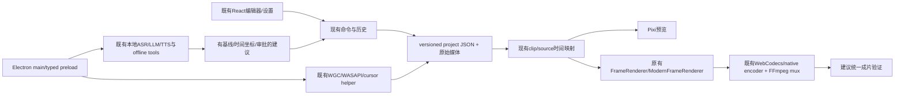

# 06 — 保留现有边界的整合架构

日期：2026-10-24。研究与设计，不是以下模块已经全部实现。A-01版本守卫是本轮唯一核心修复，见01。无WPF、无新录制器、无第二FFmpeg特效导出器、无新增依赖/模型。

## 当前路径与演进接口

| 现有模块 | 保留项 | 建议新增/改良契约 | 参考 | 接入风险 |
|---|---|---|---|---|
| Capture | useScreenRecorder、registerRecordingHandlers、wgc helper | capture health、clock epoch、可用空间、设备故障事件；不要让renderer直接调用任意helper | OBS/ShareX/wcap | native/DPI/音频最高风险，先实机 |
| Project | projectPersistence、atomicSave、snapshot/lifecycle | 共享version守卫已补；后续只允许显式迁移、relink映射、恢复候选及资源引用清单 | Cap/ScreenToGif | 所有错误保留原JSON/媒体，旧客户端不能自动降级 |
| Editor | clipSequence、history、applyEditPlan | 定义TrackState锁定/显示/静音；命令入口统一验证而非UI单独挡 | Kdenlive/Shotcut | ripple/关联cue/zoom/camera须一个事务 |
| Rendering | Pixi、layout、cursor、annotation/caption renderer | 同一EffectSnapshot和时间输入；新增类型必须同时支持两renderer | Cap/既有实现 | 不在CSS预览偷偷做成片没有的效果 |
| Encoding | existing encoder probe、VideoExporter/ModernVideoExporter | ExportHealthValidator：容器/视频可解码/音轨/时长；可取消且保留临时结果供Save Again | Cap | 不重新渲染、不复制第二mux路线 |
| AI分析 | bundled ASR/VAD/llama、已有scene适配 | AnalysisResult含source hash、模型revision、时间单位、confidence、warnings；结构校验后生成proposal | Whisper/PySceneDetect | stale plan、猜测口头禅、错误source坐标 |
| 搜索 | 不修改现有Firebase/Firestore模块 | 将来可选LocalSearchAdapter；embedding生成与Faiss索引分开 | Faiss | 不把索引等同视频理解；配额/租户隔离由对应后端落实 |

## 跨语言选择

1. **参考算法独立实现（首选）**：QPC/暂停时间映射、点击聚类、自适应响度、track/ripple、资源预算。根据规格写TS/现有native代码，不翻译不明许可源文件。可用fixture对行为对照，但不偷带上游测试素材。
2. **现有CLI边界（次选）**：继续使用已有FFmpeg、Whisper/llama/Piper。主进程固定可执行路径、argv、cwd和可用协议；每作业有取消/超时/退出码及临时目录。模型不得由外部项目脚本在启动时下载。
3. **Native module**：仅性能证据表明IPC/CLI达不到要求时考虑。N-API/ABI、Electron版本、x64/ARM、签名、rebuild与崩溃影响均要进入release gate。不能把C#/Swift/Qt库直接当Node库。
4. **Python sidecar**：PySceneDetect已有离线工具边界可复用。faster-whisper只作对照实验时使用外部测试环境；未证明收益前不把Python/CTranslate2/PyTorch打入Windows安装包。
5. **放弃直接整合**：Kap/Kooha/BetterCapture的macOS/Linux捕获后端；WPF/MLT整引擎；Remotion自定义许可管线；Real-ESRGAN/头像大运行时当前不引。

## Windows 发布与进程管理

- 保留现有helper manifest、资源锁定及checksum；新二进制需固定source commit、编译链、对应license/notice、SHA、架构和最低CPU指令集。不能仅拷一个下载的EXE。
- 应用、helper和更新器分别核验代码签名、更新feed来源、完整性和干净Windows安装行为；开源许可不替代签名。
- 单一JobManager/现有running map统一owner WebContents、取消信号、窗口关闭/进程退出清理和并发预算。先转录、再LLM，避免双重模型驻留；运行必要的小本地server不是云服务。
- 同一参数快照驱动保存、preview和export；持续保留source-ms、timeline-ms和frame timestamp的单位，禁止隐式乘除1000混用。
- 临时目录区分未提交输出、缓存、原素材和仍被工程引用的派生音频；清理只删除本作业owned paths。恢复UI先展示候选，不直接覆盖用户文件。

## 性能预算的计算方式

本轮不提供未测量的“提速百分比”。1080p RGBA单帧约7.9MiB，4K约31.6MiB；应以并发纹理/解码帧数×单帧大小估算基础预算，加浏览器/编码/音频/模型另算。Faiss float32向量基础存储约N×维数×4字节，实际索引有额外开销。已有Qwen两项锁定权重总约1.55GB（磁盘），绝不等同推理RAM。

先记录预览FPS/掉帧、seek p95、工作集/峰值、encode/decode队列、stage耗时。CPU worker不能阻塞React；GPU试编码失败回退既有软件路径并保留明确诊断。测试同机器同素材同参数，不能比较不同质量预设的速度。
